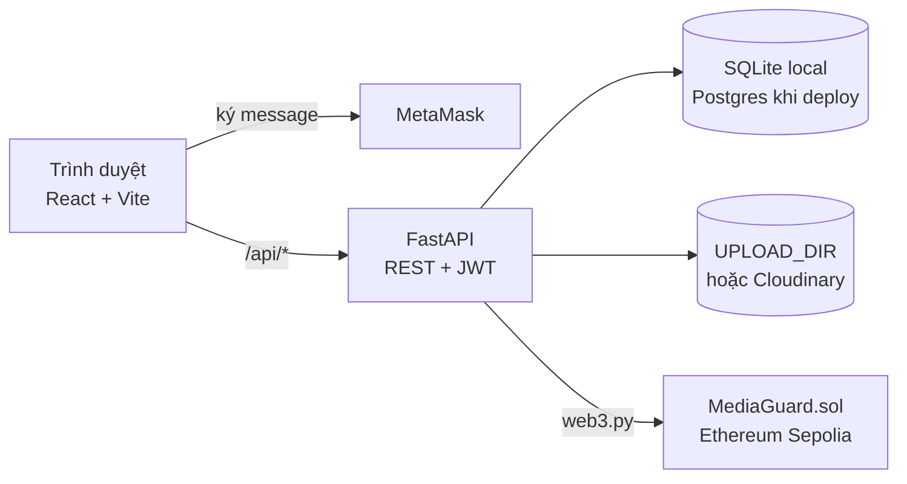

# MediaGuard

[](https://github.com/Luzji/Web_project/actions/workflows/ci.yml)

MediaGuard là ứng dụng đăng ký và xác minh quyền sở hữu tác phẩm số. Hệ thống dùng SHA-256, pHash (ảnh), so khớp văn bản (written work), xác thực ví MetaMask và bằng chứng on-chain trên Ethereum Sepolia. Hỗ trợ ảnh và written work dạng TXT, Markdown hoặc PDF có text.

## Demo đã deploy

| Thành phần | URL |
|---|---|
| Frontend (Vercel) | https://web-project-sigma-five.vercel.app |
| Backend API (Render) | https://web-project-q18h.onrender.com |
| Swagger UI | https://web-project-q18h.onrender.com/docs |
| Health check | https://web-project-q18h.onrender.com/health |

- Render Free tự ngủ khi không có truy cập; request đầu tiên có thể mất 30–60 giây để backend thức dậy (giao diện có hiển thị trạng thái chờ).
- **Không cần tài khoản** để xem Gallery, trang chi tiết tác phẩm và trang Verify.
- Để đăng ký tác phẩm: tạo tài khoản trong giao diện, kết nối MetaMask và ký thông điệp xác thực ví. Người dùng chỉ ký message, không trả gas; backend ký và gửi giao dịch lên Sepolia.
- Frontend production gọi `/api/*`; `frontend/vercel.json` rewrite các request này tới backend Render.

## Chạy bằng một lệnh (Docker)

Cần Docker Desktop (Windows/macOS) hoặc Docker Engine + Compose plugin (Linux). Kiểm tra: `docker compose version`.

**macOS / Linux**

```bash
git clone https://github.com/Luzji/Web_project.git && cd Web_project && (test -f .env || cp .env.example .env) && docker compose up -d --build --wait
```

**Windows PowerShell**

```powershell
git clone https://github.com/Luzji/Web_project.git; cd Web_project; .\run.ps1
```

Nếu PowerShell chặn script: `powershell -ExecutionPolicy Bypass -File .\run.ps1`.

`docker-compose.yml` cần file `.env`; lệnh trên chỉ tạo nó từ `.env.example` khi chưa có, không ghi đè file cũ. Frontend chỉ khởi động sau khi healthcheck của backend đạt.

| Thành phần | URL local |
|---|---|
| Frontend | http://localhost:5173 |
| Backend API | http://localhost:8000 |
| Swagger UI | http://localhost:8000/docs |
| Health check | http://localhost:8000/health |

Đã có repo trên máy: chạy `git pull --ff-only origin main` rồi chạy lại lệnh `docker compose up -d --build --wait`.

```bash
docker compose logs -f     # xem log
docker compose down        # dừng
docker compose down -v     # dừng và xóa database + file upload local (volume backend_data)
```

### Dữ liệu demo mẫu

Sau khi stack chạy, tạo 8 tác phẩm mẫu (3 ảnh, 5 written work) cho Gallery:

```bash
docker compose exec backend python scripts/seed_demo.py --reset-demo
```

File seed nằm trong volume `backend_data` (cùng `UPLOAD_DIR` với backend), không được commit vào Git. Các tác phẩm mẫu có trạng thái `approved_local` (chưa có bằng chứng on-chain). Refresh http://localhost:5173 để xem.

## Cấu hình `.env`

`.env.example` có đủ biến để chạy local; không cần sửa gì để xem giao diện, đăng nhập và upload. **Không commit `.env`, private key, API key hay file upload.**

| Biến | Ý nghĩa |
|---|---|
| `ENV` | `development` (mặc định) hoặc `production`. Production bắt buộc `JWT_SECRET` ≥ 32 ký tự và không bắt đầu bằng `REPLACE_ME`. |
| `JWT_SECRET` | Khóa ký JWT. Tạo bằng `python -c "import secrets; print(secrets.token_urlsafe(32))"`. |
| `DATABASE_URL` | SQLite mặc định; dùng chuỗi Postgres khi deploy (`postgres://` và `postgresql://` được tự chuyển sang driver psycopg2). |
| `UPLOAD_DIR`, `MAX_UPLOAD_MB` | Thư mục lưu file và giới hạn dung lượng (mặc định 10 MB). |
| `CORS_ORIGINS` | Danh sách origin được phép, cách nhau bằng dấu phẩy. Chỉ cần khi frontend gọi thẳng backend. |
| `VERIFY_RATE_LIMIT`, `AUTH_RATE_LIMIT` | Số lượt/phút/IP cho `/verify` (30) và các endpoint đăng nhập/đăng ký (10). |
| `WEB3_RPC_URL`, `BACKEND_PRIVATE_KEY`, `CONTRACT_ADDRESS` | Bật ghi bằng chứng on-chain trên Sepolia. Thiếu một trong ba thì tác phẩm vẫn đăng ký được nhưng ở trạng thái `approved_local`. |
| `CHAIN_START_BLOCK` | Block bắt đầu quét event khi khôi phục `tx_hash` (mặc định 0). |
| `CLOUDINARY_CLOUD_NAME`, `CLOUDINARY_API_KEY`, `CLOUDINARY_API_SECRET` | Tùy chọn: lưu file trên Cloudinary thay vì `UPLOAD_DIR`. Cần đủ cả ba. |
| `SEPOLIA_RPC_URL`, `DEPLOYER_PRIVATE_KEY`, `ETHERSCAN_API_KEY` | Chỉ dùng khi deploy smart contract bằng Hardhat. |

Compose tự đặt `DATABASE_URL=sqlite:////data/mediaguard.db`, `UPLOAD_DIR=/data/uploads`, `CORS_ORIGINS` cho `localhost:5173` / `127.0.0.1:5173` và `VITE_API_BASE=http://localhost:8000`.

## Chạy không dùng Docker

Cần Python 3.12 và Node.js 20 (cùng phiên bản với Dockerfile và CI).

**Backend** (macOS/Linux):

```bash
cd backend
python -m venv venv
./venv/bin/pip install -r requirements.txt
cp ../.env.example .env
./venv/bin/uvicorn app.main:app --reload --port 8000
```

**Backend** (Windows PowerShell):

```powershell
cd backend
python -m venv venv
.\venv\Scripts\pip install -r requirements.txt
Copy-Item ..\.env.example .env
.\venv\Scripts\uvicorn app.main:app --reload --port 8000
```

**Frontend** (terminal thứ hai):

```bash
cd frontend
npm install
npm run dev
```

Mở http://localhost:5173. Vite proxy `/api` tới `http://localhost:8000`. Nếu backend ở URL khác, tạo `frontend/.env.local` với `VITE_API_BASE=https://your-api.example.com`.

Seed dữ liệu demo khi chạy kiểu này: `cd backend && python scripts/seed_demo.py --reset-demo`.

## Kiến trúc



```text
backend/     FastAPI: routers/ (auth, artworks), services/ (ảnh, văn bản, ví, blockchain, rate limit, lưu trữ), tests/, scripts/seed_demo.py
frontend/    React 18 + TypeScript + Vite, ethers v6; routes /, /protect, /verify, /works/:id, /works/:id/certificate
contracts/   MediaGuard.sol (register, verify, revoke)
test/        Test smart contract (Hardhat)
scripts/     deploy.js (tạo backend/app/contract_deployment.json)
```

Luồng đăng ký: đăng nhập → `POST /auth/wallet/nonce` → MetaMask ký message → `POST /auth/wallet/verify` → `POST /artworks/register`. Backend stream file với giới hạn dung lượng, kiểm tra file hợp lệ, tính SHA-256 và pHash/độ tương đồng văn bản (từ 85% trở lên bị từ chối là quá giống), lưu bản ghi rồi gọi `register` trên contract.

Trạng thái tác phẩm: `pending_chain`, `protected` (đã có giao dịch on-chain), `approved_local` (chưa ghi on-chain), `chain_failed`. Gallery hiển thị mọi tác phẩm public ở cả bốn trạng thái; huy hiệu và bộ lọc "on-chain" cho biết tác phẩm nào đã có bằng chứng.

## API chính

| Method | Endpoint | Quyền | Mô tả |
|---|---|---|---|
| GET | `/health` | công khai | Kiểm tra backend |
| POST | `/auth/register` | công khai | Tạo tài khoản, trả JWT (giới hạn tốc độ) |
| POST | `/auth/login`, `/auth/token` | công khai | Đăng nhập (`/auth/token` là OAuth2 form cho Swagger) |
| POST | `/auth/wallet/nonce` | Bearer | Lấy nonce và message để ký |
| POST | `/auth/wallet/verify` | Bearer | Xác thực chữ ký ví |
| GET | `/artworks` | tùy chọn | Danh sách tác phẩm public |
| GET | `/artworks/{id}` | tùy chọn | Chi tiết (tác phẩm private chỉ chủ sở hữu xem được) |
| GET | `/artworks/{id}/download` | công khai | Tải file, chỉ khi tác phẩm cho phép |
| POST | `/artworks/register` | Bearer + ví đã xác thực | Upload và đăng ký (multipart) |
| POST | `/verify` | công khai | Đối chiếu file với database và chain (giới hạn tốc độ) |
| POST | `/artworks/{id}/retry-chain` | Bearer, chủ sở hữu | Thử ghi lại lên chain; backend kiểm tra chain trước khi gửi giao dịch mới |

Mã lỗi thường gặp: 401 (token), 403 (chưa xác thực ví / không phải chủ sở hữu), 409 (trùng SHA-256 hoặc quá giống), 413 (file quá lớn), 415 (định dạng không hỗ trợ), 422 (dữ liệu sai), 429 (quá giới hạn tốc độ). Chi tiết ở Swagger UI.

## Smart contract

```bash
npm install
npm run compile
cp .env.example .env        # điền SEPOLIA_RPC_URL, DEPLOYER_PRIVATE_KEY
npm run deploy:sepolia      # ghi backend/app/contract_deployment.json
```

Sau đó đặt `CONTRACT_ADDRESS` (địa chỉ in ra khi deploy) cùng `WEB3_RPC_URL` và `BACKEND_PRIVATE_KEY` cho backend.

## Test và CI

```bash
# Backend: kích hoạt venv của backend, rồi ở thư mục gốc repo
pip install pytest
pytest

# Smart contract (thư mục gốc)
npm test

# Frontend
cd frontend && npm test && npm run build
```

GitHub Actions (`.github/workflows/ci.yml`) chạy ba job trên mỗi push vào `main` và mỗi pull request: pytest (Python 3.12), test + build frontend (Node 20) và Hardhat test. Test backend dùng SQLite tạm từ `backend/tests/conftest.py`.

## Triển khai

- **Backend (Render):** đặt `ENV=production`, `JWT_SECRET`, `DATABASE_URL` (Postgres), `CLOUDINARY_*`, `WEB3_RPC_URL`, `BACKEND_PRIVATE_KEY`, `CONTRACT_ADDRESS`. Không đặt secret trong repo.
- **Frontend (Vercel):** `frontend/vercel.json` rewrite `/api/*` tới backend Render và mọi route còn lại về `index.html`.

## Xử lý lỗi thường gặp

- **`docker compose` báo thiếu `.env`:** đứng ở thư mục gốc repo và chạy `test -f .env || cp .env.example .env` (Windows: `.\run.ps1`).
- **Backend chưa healthy:** `docker compose logs -f backend` và `curl http://localhost:8000/health`. Lần build đầu có thể cần thêm thời gian.
- **Port 5173 hoặc 8000 đã bị dùng:** đổi port bên trái trong `docker-compose.yml` (ví dụ `"5174:5173"`) và thêm origin mới vào `CORS_ORIGINS`.
- **Sửa code nhưng giao diện không đổi:** `docker compose up -d --build`; nếu vẫn cache cũ, `docker compose build --no-cache`.
- **Ảnh demo không hiện:** chạy lại seed bằng lệnh ở mục "Dữ liệu demo mẫu" sau khi cập nhật code.

## Giới hạn

- SQLite phù hợp cho local/demo. Khi chạy nhiều worker/instance, dùng Postgres cùng cơ chế khóa phân tán hoặc hàng đợi giao dịch; lock hiện tại (theo hash file, theo nonce) chỉ có tác dụng trong một process.
- Rate limit theo IP của request; khi đặt sau reverse proxy cần kiểm tra IP backend nhìn thấy.
- Đã có sẵn trong code: chống gửi trùng giao dịch cho cùng một file, cache client RPC, migration cộng thêm cột cho SQLite cũ.
